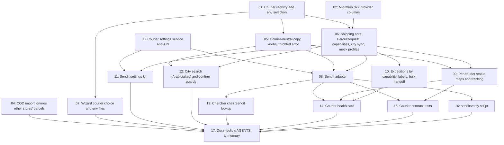

# Sendit Courier

## Overview

Add Sendit (sendit.ma) as a second courier next to Ozon Express, chosen per store copy in `npm run new-store`. The shipping layer becomes a small courier registry with capabilities (Ozon = BL flow, Sendit = 10×10 labels + parcel lookup), so the CRM adapts to the active courier and future couriers are cheap to add. Ozon stores behave exactly as today. Supersedes WhatsApp spec tasks 20 and 27.

## Quick Links

- [Requirements](./requirements.md) — decisions, Sendit API reference, status mapping, acceptance criteria
- [Action Required](./action-required.md) — manual steps (Sendit keys, live verification, pickup district)

## Project Rules (apply to every task)

- Read `AGENTS.md` first; its invariants override anything here.
- Finish with `npm run lint` and `npx tsc --noEmit` passing, plus every existing suite the task touches (`npm run test:unit`, `npm run test:crm`, `npm run test:catalog-agent`, `npm run test:assistant`…).
- Tests: `DELIVERY_PROVIDER=mock`, temp `DB_PATH`, ephemeral secrets, stubbed `fetch`, `NODE_OPTIONS=--import=$PWD/scripts/block-external-network.mjs`. Never call live Sendit/Ozon, never load `.env*`.
- CRM copy French, integer MAD. Never edit applied migrations. Don't commit.
- Ozon behaviour must not change. When in doubt, gate new behaviour on the active courier's capabilities.

## Dependency Graph

## Waves

| Wave | Tasks | Description |
|------|-------|-------------|
| 1 | task-01 to task-04 | Registry + env selection, migration, courier settings service, COD shared-account fix |
| 2 | task-05 to task-07 | Neutral copy/knobs/throttled kind, shipping core refactor + mock profiles, wizard |
| 3 | task-08 to task-12 | Sendit adapter, status maps, capability-driven Expéditions, settings UI, city search/guards |
| 4 | task-13 to task-16 | Lookup helper, health card, contract tests, live verify script |
| 5 | task-17 | Docs, policy, AGENTS.md, ai-memory README |
| Deferred | task-18, task-19 | Sendit webhook, Sendit parcel edit (do not implement now) |

## Task Status

### Wave 1
- [x] [task-01-courier-registry-env](./tasks/task-01-courier-registry-env.md) — Courier registry and env selection
- [x] [task-02-migration-provider-columns](./tasks/task-02-migration-provider-columns.md) — Migration 029 provider columns
- [x] [task-03-courier-settings-service](./tasks/task-03-courier-settings-service.md) — Courier settings service and API
- [x] [task-04-cod-foreign-lines](./tasks/task-04-cod-foreign-lines.md) — COD import ignores other stores' parcels

### Wave 2
- [x] [task-05-neutral-copy-knobs](./tasks/task-05-neutral-copy-knobs.md) — Courier-neutral copy, COURIER_* knobs, throttled error kind
- [x] [task-06-shipping-core-refactor](./tasks/task-06-shipping-core-refactor.md) — ParcelRequest, capabilities, shared city sync, mock profiles
- [x] [task-07-wizard-courier-choice](./tasks/task-07-wizard-courier-choice.md) — Wizard courier choice and env files

### Wave 3
- [x] [task-08-sendit-adapter](./tasks/task-08-sendit-adapter.md) — Sendit adapter
- [x] [task-09-status-maps-tracking](./tasks/task-09-status-maps-tracking.md) — Per-courier status maps and tracking filter
- [x] [task-10-expeditions-capabilities](./tasks/task-10-expeditions-capabilities.md) — Expeditions by capability, labels, bulk handoff
- [x] [task-11-courier-settings-ui](./tasks/task-11-courier-settings-ui.md) — Sendit settings UI
- [x] [task-12-city-search-confirm-guards](./tasks/task-12-city-search-confirm-guards.md) — Arabic/alias city search and confirm guards

### Wave 4
- [x] [task-13-sendit-parcel-lookup](./tasks/task-13-sendit-parcel-lookup.md) — "Chercher chez Sendit" lookup
- [x] [task-14-courier-health](./tasks/task-14-courier-health.md) — Courier health card and /api/health
- [x] [task-15-courier-contract-tests](./tasks/task-15-courier-contract-tests.md) — Courier contract tests
- [x] [task-16-sendit-verify-script](./tasks/task-16-sendit-verify-script.md) — sendit:verify live read-only script

### Wave 5
- [ ] [task-17-docs-policy](./tasks/task-17-docs-policy.md) — Docs, policy, AGENTS.md, ai-memory README

### Deferred (not part of implementation runs)
- [ ] [task-18-sendit-webhook](./tasks/task-18-sendit-webhook.md) — Sendit status webhook (deferred)
- [ ] [task-19-sendit-parcel-edit](./tasks/task-19-sendit-parcel-edit.md) — Sendit parcel edit via PUT (deferred)
