# WhatsApp Assistant

## Overview

Connect each store copy to its own WhatsApp number through a self-hosted Evolution API. The feature has four parts:
- **Plain-text parcel and order notifications** (no templates).
- **Admin alerts** on every confirmation.
- **Inbound handling** of text, voice notes and images, with an OpenRouter AI agent (GLM 5.3 Flash, with DeepSeek V4.1 Flash as fallback and Gemini Flash-Lite for audio) that answers 24/7 using CRM data.
- **A strike and auto-block system and a CRM inbox** with human takeover.

Safety comes first:
- The customer writes first.
- Outbound sending is paced.
- An uncertain send is never resent blindly.
- Each order is visible only to its owner.
- Humans approve every order mutation.
- Every risky feature is OFF by default, and there's a kill switch.

Later phases add catalog suggestions, order-edit proposals, courier raw-status mapping and a Sendit adapter (blocked until credentials and docs exist).

## Quick Links

- [Requirements](./requirements.md): every decision from planning, goals, non-goals and acceptance criteria
- [Action Required](./action-required.md): manual steps (SIM, Evolution deploy, env, voice notes, Sendit credentials)

## Project Rules (apply to every task)

- Read `AGENTS.md` at the repo root first. Its invariants override anything here (task 01 adds the narrow webhook exception).
- Finish with `npm run lint` and `npx tsc --noEmit` passing, plus existing suites touched by the task (`npm run test:unit`, `npm run test:crm`, etc.).
- Tests must use `DELIVERY_PROVIDER=mock`, a temp `DB_PATH` (`fs.mkdtempSync`), ephemeral secrets, mocked `fetch` for Evolution and OpenRouter, and `NODE_OPTIONS=--import=$PWD/scripts/block-external-network.mjs`. New unit tests go in `scripts/unit/<name>.test.mjs` and load TS with `import { loadSource } from "../test-source.mjs"`.
- CRM copy is French. Storefront copy comes from `store.config.ts` and `src/config/i18n.ts` (fr and ar). Prices are integer MAD. Timezone is Africa/Casablanca.
- Never edit an applied migration. Never load `.env*` files, call live couriers, call a live Evolution instance or call OpenRouter in tests. Don't commit.
- Secrets belong only in runtime env. Never put secrets, phone numbers or message bodies in logs (use `src/lib/log.ts`, which sanitizes).

## Conventions

- Reserved migration: `migrations/028_whatsapp.sql`. Task 02 creates all tables. Later tasks never add migrations. `029_courier_providers.sql` belongs to `specs/sendit-courier/` (it owns the `provider` columns); task 19 here requires it.
- Tasks 20 and 27 are **superseded** by `specs/sendit-courier/`; skip them.
- New code lives in `src/lib/whatsapp/` (pure and integration helpers) and in `src/lib/services/whatsapp-*.ts` (DB services). The worker is `src/lib/workers/whatsapp.ts`.
- Hot files pass between waves in a fixed order:
  - `src/app/(admin)/crm/parametres/page.tsx`: task 14 (wave 2), then task 19 (wave 3).
  - `src/lib/whatsapp/ai/agent.ts`: task 17 (wave 3), then task 23 (wave 4).
  - `src/lib/workers/index.ts` and `src/lib/services/worker-status.ts`: task 24 only.
  - `src/app/(admin)/crm/orders/[id]/page.tsx`: task 25 only.

## Dependency Graph

```mermaid
graph TD
  T01["01: Policy exception, docs and env examples"]
  T02["02: Migration 028 WhatsApp schema"]
  T03["03: WhatsApp env config and boot validation"]
  T04["04: WhatsApp settings schema, service and API"]
  T05["05: Phone/JID helpers and message copy"]
  T06["06: Evolution API client"]
  T07["07: Outbox service with pacing"]
  T08["08: Conversations, messages and identity"]
  T09["09: Strikes and auto-block"]
  T10["10: Webhook ingest route"]
  T11["11: OpenRouter models, transcription, classifier, budget"]
  T12["12: Drafts, proposals and WhatsApp requests"]
  T13["13: Thank-you page WhatsApp button"]
  T14["14: WhatsApp settings UI"]
  T15["15: Notification triggers"]
  T16["16: Media pipeline"]
  T17["17: AI agent, prompt and core tools"]
  T18["18: Inbox API routes"]
  T19["19: Courier raw-status mapping"]
  T20["20: Courier provider groundwork"]
  T21["21: Inbound processor"]
  T22["22: CRM inbox UI"]
  T23["23: Catalog tools for the AI"]
  T24["24: WhatsApp worker and health"]
  T25["25: Order page panel, proposals and requests UI"]
  T26["26: Darija evaluation harness"]
  T27["27: Sendit adapter (BLOCKED)"]
  T03 --> T06
  T02 --> T07
  T04 --> T07
  T05 --> T07
  T02 --> T08
  T05 --> T08
  T02 --> T09
  T04 --> T09
  T02 --> T10
  T03 --> T10
  T02 --> T11
  T03 --> T11
  T04 --> T11
  T02 --> T12
  T05 --> T13
  T04 --> T14
  T05 --> T15
  T07 --> T15
  T09 --> T15
  T12 --> T15
  T06 --> T16
  T04 --> T16
  T08 --> T17
  T11 --> T17
  T12 --> T17
  T07 --> T18
  T08 --> T18
  T09 --> T18
  T12 --> T18
  T07 --> T19
  T02 --> T20
  T07 --> T21
  T08 --> T21
  T09 --> T21
  T11 --> T21
  T10 --> T21
  T16 --> T21
  T17 --> T21
  T18 --> T22
  T17 --> T23
  T06 --> T24
  T21 --> T24
  T18 --> T25
  T12 --> T25
  T23 --> T26
  T11 --> T26
  T20 --> T27
```

## Waves

| Wave | Tasks | Description |
|------|-------|-------------|
| 1 | task-01 to task-05 | Policy and docs, schema, env config, settings, phone and copy helpers |
| 2 | task-06 to task-14 | Evolution client, outbox, conversations, strikes, webhook, AI models, drafts and proposals, thank-you button, settings UI |
| 3 | task-15 to task-20 | Notification triggers, media, AI agent, inbox API, status mapping, provider groundwork |
| 4 | task-21 to task-23 | Inbound processor, inbox UI, catalog tools |
| 5 | task-24 to task-26 | Worker and health, order page panel, Darija evaluation |
| 6 | task-27 | Sendit adapter (blocked until credentials and docs) |

## Task Status

### Wave 1
- [x] [task-01-policy-docs-env](./tasks/task-01-policy-docs-env.md): Policy exception, docs and env examples
- [x] [task-02-migration-whatsapp](./tasks/task-02-migration-whatsapp.md): Migration 028 WhatsApp schema
- [x] [task-03-whatsapp-config](./tasks/task-03-whatsapp-config.md): WhatsApp env config and boot validation
- [x] [task-04-whatsapp-settings](./tasks/task-04-whatsapp-settings.md): WhatsApp settings schema, service and API
- [x] [task-05-phone-and-copy](./tasks/task-05-phone-and-copy.md): Phone/JID helpers and message copy

### Wave 2
- [x] [task-06-evolution-client](./tasks/task-06-evolution-client.md): Evolution API client
- [x] [task-07-outbox-service](./tasks/task-07-outbox-service.md): Outbox service with pacing
- [x] [task-08-conversations-service](./tasks/task-08-conversations-service.md): Conversations, messages and identity
- [x] [task-09-strikes-autoblock](./tasks/task-09-strikes-autoblock.md): Strikes and auto-block
- [x] [task-10-webhook-ingest](./tasks/task-10-webhook-ingest.md): Webhook ingest route
- [x] [task-11-ai-models-budget](./tasks/task-11-ai-models-budget.md): OpenRouter models, transcription, classifier, budget
- [x] [task-12-drafts-proposals-requests](./tasks/task-12-drafts-proposals-requests.md): Drafts, proposals and WhatsApp requests
- [x] [task-13-thank-you-button](./tasks/task-13-thank-you-button.md): Thank-you page WhatsApp button
- [x] [task-14-settings-ui](./tasks/task-14-settings-ui.md): WhatsApp settings UI

### Wave 3
- [x] [task-15-notification-triggers](./tasks/task-15-notification-triggers.md): Notification triggers
- [x] [task-16-media-pipeline](./tasks/task-16-media-pipeline.md): Media pipeline
- [x] [task-17-ai-agent](./tasks/task-17-ai-agent.md): AI agent, prompt and core tools
- [x] [task-18-inbox-api](./tasks/task-18-inbox-api.md): Inbox API routes
- [x] [task-19-courier-status-mapping](./tasks/task-19-courier-status-mapping.md): Courier raw-status mapping
- [x] [task-20-courier-provider-groundwork](./tasks/task-20-courier-provider-groundwork.md): Courier provider groundwork — SUPERSEDED by specs/sendit-courier

### Wave 4
- [x] [task-21-inbound-processor](./tasks/task-21-inbound-processor.md): Inbound processor
- [x] [task-22-inbox-ui](./tasks/task-22-inbox-ui.md): CRM inbox UI
- [x] [task-23-catalog-tools](./tasks/task-23-catalog-tools.md): Catalog tools for the AI

### Wave 5
- [ ] [task-24-whatsapp-worker](./tasks/task-24-whatsapp-worker.md): WhatsApp worker and health
- [ ] [task-25-order-panel-proposals-ui](./tasks/task-25-order-panel-proposals-ui.md): Order page panel, proposals and requests UI
- [ ] [task-26-darija-eval](./tasks/task-26-darija-eval.md): Darija evaluation harness

### Wave 6
- [x] [task-27-sendit-adapter](./tasks/task-27-sendit-adapter.md): Sendit adapter — SUPERSEDED by specs/sendit-courier
